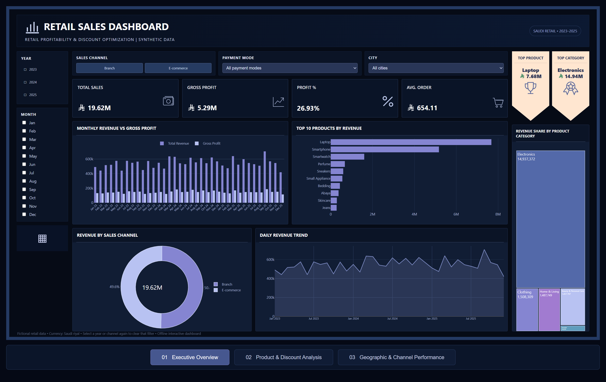
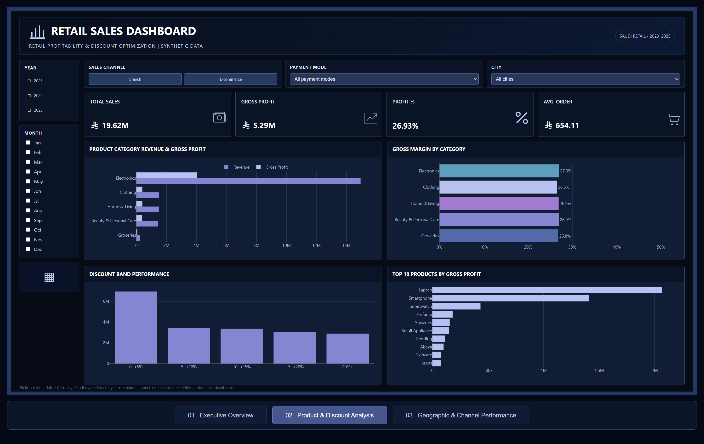
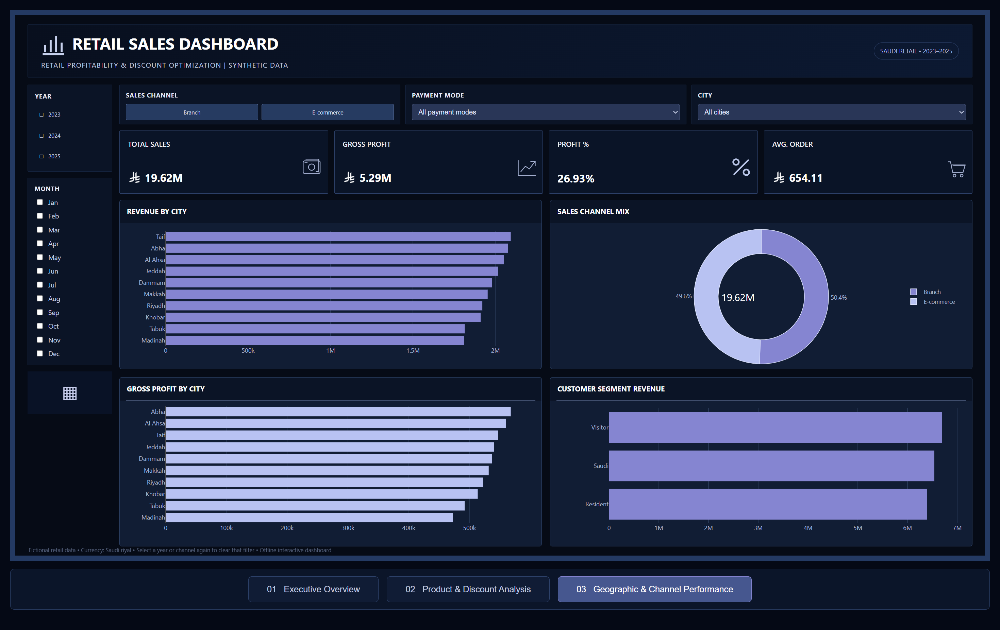

# Saudi Retail Profitability & Revenue Driver Analysis

### Business intelligence portfolio case study | 30,000 synthetic transactions | 2023–2025

**Focus:** Revenue concentration · Gross margin · Discount effectiveness · Product performance · Geographic and channel analysis

> **Dataset disclosure:** This project analyzes a fictional Saudi retail dataset. Results are simulated analytical findings, not actual company performance. Recommendations have not been implemented or measured in a real business.

## Executive overview



A fictional multi-city retailer needed visibility into which products, categories, sales channels, and locations were driving sales and estimated gross profitability. I analyzed 30,000 transaction records and developed a three-page reporting experience to support commercial decisions.

| Key performance indicator | Result |
|---|---:|
| Total revenue | **SAR 19.62M** |
| Estimated gross profit | **SAR 5.29M** |
| Estimated gross margin | **26.93%** |
| Transactions | **30,000** |
| Average order value | **SAR 654.11** |

## Business insights and recommendations

### 1. Electronics revenue concentration

**Finding:** Electronics contributed approximately **76.1% of total revenue**, or **SAR 14.94M**. Laptops and smartphones were especially important revenue drivers.

**Commercial implication:** Sales performance is sensitive to a relatively concentrated product mix.

**Recommendation:** Monitor high-value electronics inventory and product-level profitability while exploring diversification opportunities.

### 2. Gross margin varies by discount band

**Finding:** Non-discounted transactions generated an estimated **32.93% gross margin**, compared with **18.94%** for transactions discounted above 10% — a **13.99 percentage-point difference**.

**Commercial implication:** Deeper discounts are associated with lower estimated gross margins, although this does not prove that removing discounts would increase profit.

**Recommendation:** Evaluate promotion performance by product and discount band; use controlled tests before revising pricing policies.

### 3. Channels are balanced; city-level performance differs

**Finding:** Branch sales generated approximately **50.4%** of revenue, and E-commerce **49.6%**. Geographic margins vary, creating opportunities for more detailed analysis.

**Recommendation:** Monitor both channels consistently and investigate city-level product mix, pricing, and discounts.

## Dashboard gallery

### 01 — Executive Overview


**Includes:** revenue and profit KPIs, monthly performance, top products, sales-channel mix, and product-category revenue contribution.

### 02 — Product & Discount Analysis



**Includes:** category revenue and gross profit, category margins, discount-band performance, and top products by gross profit.

### 03 — Geographic & Channel Performance



**Includes:** city revenue, gross profit by city, sales-channel mix, and customer-segment revenue.

> The three images are screenshots of the interactive dashboard. **The executable HTML dashboard is not currently included in this repository**, so the GitHub page provides a visual portfolio showcase rather than a live interactive report. The screenshots are not a native Power BI (.pbix) or Tableau (.twbx) file.

## Data and analysis workflow

1. **Data preparation:** Review transaction identifiers, dates, monetary values, categories, locations, discounts, and sales channels in the synthetic CSV.
2. **Data quality:** Validate 30,000 unique transaction IDs and check for blank identifiers or invalid numeric records.
3. **Financial analysis:** Aggregate revenue and estimated gross profit, calculate gross margins and average order values, and compare category, channel, discount, and geographic performance.
4. **Reporting:** Present results through executive, product/discount, and geographic/channel dashboard views.
5. **Recommendations:** Translate descriptive findings into testable business actions, without claiming unverified savings or implemented impact.

### Core KPI definitions

- **Revenue:** Sum of `sales_amount_sar`.
- **Estimated gross profit:** Sum of `estimated_gross_profit_sar`.
- **Gross margin:** Estimated gross profit ÷ revenue × 100.
- **Average order value:** Revenue ÷ distinct transaction count.
- **Category revenue share:** Category revenue ÷ total revenue within the current analysis context.

### Example SQL

The repository includes [PostgreSQL-style example queries](sql/retail_analysis.sql) for aggregating KPIs, category contribution, and discount bands. These are reproducible examples, **not evidence of an executed production SQL pipeline**.

## Repository structure

```text
saudi-retail-profitability-analysis/
├── README.md
├── 05_retail_transactions_synthetic.csv
├── RetailSales-Dashboard_Executive-Overview.png
├── RetailSales-Dashboard_Product&Discount-Analysis.png
├── RetailSales-Dashboard_Geographic&Channel-Performance.png
├── analysis/
│   ├── 01_data_quality.csv
│   ├── 02_overall_kpis.csv
│   ├── 04_category_performance.csv
│   ├── 06_channel_performance.csv
│   └── 07_discount_bands.csv
└── sql/
    └── retail_analysis.sql
```

## Explore the files

- [Original synthetic dataset](data/05_retail_transactions_synthetic.csv)
- [Dashboard screenshot gallery](assets/)

- [Download / view the original synthetic dataset](data/05_retail_transactions_synthetic.csv)
- [Data-quality summary](analysis/01_data_quality.csv)
- [Overall financial KPIs](analysis/02_overall_kpis.csv)
- [Category performance](analysis/04_category_performance.csv)
- [Sales-channel performance](analysis/06_channel_performance.csv)
- [Discount-band analysis](analysis/07_discount_bands.csv)
- [SQL examples](sql/retail_analysis.sql)

## Tools and skills demonstrated

**Business intelligence:** KPI design, dashboard composition, interactive reporting concepts, revenue analysis, and profitability analysis.

**Data analysis:** Aggregation, segmentation, data validation, product/category ranking, and commercial recommendations.

**Technical artifacts:** CSV dataset, SQL examples, analytical summaries, and dashboard screenshots. The dashboard itself was built as an interactive HTML report; a native PBIX file is not provided here.

## Limitations

- All records are synthetic and do not describe an actual Saudi retailer.
- Gross profit is an **estimated field**, not audited accounting profit.
- Observed discount/margin differences do not establish causal effects.
- No operational improvement, time savings, or financial uplift is claimed.
- The repository currently hosts screenshots rather than the executable HTML dashboard.

---

**Portfolio project:** Retail Profitability & Revenue Driver Analysis · Saudi retail scenario · 2023–2025
